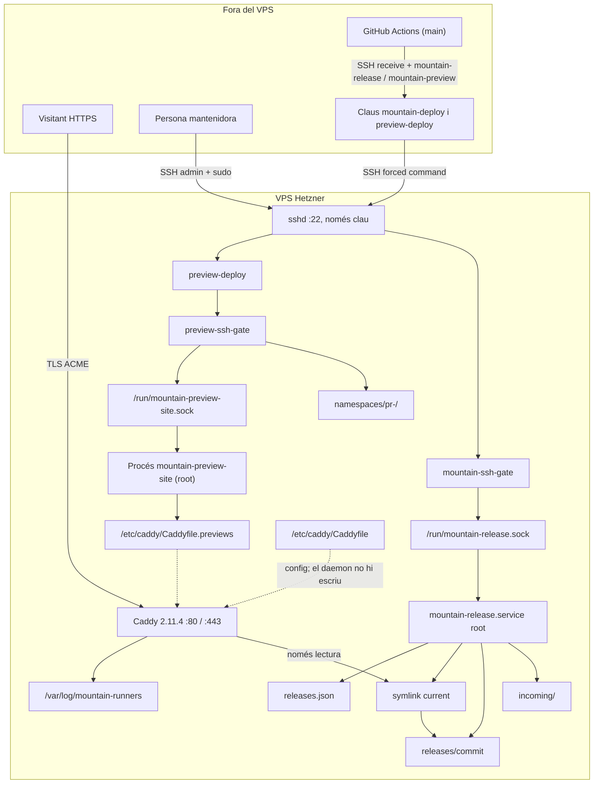

# Operacions

## Propòsit

Aquests documents descriuen l'operació mínima de producció de Mountain Runners,
organitzada per component. El contingut compartit per tots els components
(servidor, identitats, còpies, logs, salut i resposta a emergències) viu en
aquest document.

Cap acció remota (crear el VPS, registres DNS, claus SSH, secrets o activacions)
no s'executa sense l'aprovació explícita de la persona mantenidora. Cap agent,
sessió local ni assistent editorial no pot desplegar ni operar producció.

## Components

Cada document té una part «Com funciona» (contractes, fronteres i noms) i una
part «Com s'opera» (ordres, instal·lació, actualització, reversió i
incidències).

- [`web-and-releases.md`](web-and-releases.md): build i artefacte, releases,
  desplegament continu, reversió, TLS, redireccions, tall DNS, HSTS i gate de
  llançament.
- [`previews.md`](previews.md): publicador, autorització per etiqueta, gate
  `mountain-preview`, instal·lació al VPS i retirada de les previews de PR.
- [`agent.md`](agent.md): instal·lació, configuració, actualització, reversió i
  estat de l'agent privat.

## Responsables I Canal De Vulnerabilitats

- **Persona mantenidora**: administració del VPS, aprovació del primer tall,
  rollback, revocacions, logs i resposta a incidències (T5.1).
- **Canal privat de vulnerabilitats**: Private Vulnerability Reporting de
  GitHub (`SECURITY.md`), activat i provat el 16 d'agost de 2026 (T5.1).

## Servidor

### Destí

VPS de Hetzner administrat per la persona mantenidora, Debian 12 (o compatible),
amb Caddy 2.11.4 (versió pinjada i checksum SHA-512 verificat al bootstrap) com a
terminador TLS i servidor de la release activa. L'accés SSH és només amb clau
(el bootstrap desactiva l'autenticació per contrasenya); el tallafoc extern de
Hetzner només ha d'obrir 22, 80 i 443. La web estàtica i la futura API de xat
es mantenen com a unitats de desplegament separades.

### Identitats

| Identitat           | Rol                                                                                                                              |
| ------------------- | -------------------------------------------------------------------------------------------------------------------------------- |
| Persona mantenidora | Usuari administratiu no `root` amb `sudo` (accés per SSH amb clau; host key verificat)                                           |
| `mountain-deploy`   | Usuari de sistema amb shell restringit (gate + `receive` a `incoming/`); clau SSH amb `command="mountain-ssh-gate"` i `restrict` |
| Daemon de releases  | Servei systemd com a `root` (`mountain-release.service`); únic escriptor de releases, registre i `current`                       |
| `preview-deploy`    | Usuari compartit per totes les previews ([usuari i directori](previews.md#usuari-i-directori-de-previews))                       |
| `caddy`             | Usuari del paquet; només llegeix la release activa i escriu els logs                                                             |

La clau de desplegament es fixa a
`/var/lib/mountain-runners/.ssh/authorized_keys` amb `restrict`, sense PTY ni
forwarding. La identitat de desplegament no té cap accés privilegiat al
filesystem ni `sudo`: el gate tokenitza sense shell i envia la petició al daemon
per `/run/mountain-release.sock` (grup `mountain-runners`, mode 0660), que la
revalida i l'executa com a `root`. El daemon tampoc pot escriure la
configuració de Caddy, les claus TLS ni l'estat ACME.

El flux de previews —usuari, comanda forçada, socket i abast— és a
[previews](previews.md#previews-de-pull-request).

### Arquitectura Del Servidor

Aquest diagrama és la font viva de la configuració del VPS. Actualitza'l al
mateix canvi que toqui identitats, ports, paths, Caddy, el gate, el daemon o el
flux de releases (T5.4 i T5.5 incloses).

El tallafoc de Hetzner només obre 22, 80 i 443. Caddy escolta 80/443, termina
TLS amb ACME i serveix el symlink `current`. El host de validació continua al
`Caddyfile`; l'apex i `www` s'importen de `Caddyfile.production` (actiu des
del tall). El daemon de releases no escriu Caddy, claus TLS ni estat ACME.
Els nodes de previews del diagrama i el socket del seu procés són a
[previews](previews.md#frontera-del-servidor).



Operació d'una release (instal·lar o activar) des de la identitat de
desplegament:

```mermaid
sequenceDiagram
  participant Deploy as Clau mountain-deploy
  participant Gate as mountain-ssh-gate
  participant Daemon as mountain-release
  participant FS as /var/lib/mountain-runners
  participant Caddy as Caddy

  Deploy->>Gate: SSH receive (stdin) / mountain-release
  Note over Gate: tokenitza sense shell; receive escriu incoming/
  Gate->>Daemon: Unix socket
  Note over Daemon: revalida arguments com a root
  Daemon->>FS: install / activate / rollback / revoke / prune
  Caddy->>FS: serveix current
```

Operació d'una preview (receive → install → authorize → site-enable → activate)
des de la identitat de
previews:

```mermaid
sequenceDiagram
  participant Preview as Clau preview-deploy
  participant Gate as preview-ssh-gate
  participant NS as namespaces/pr-<n>/
  participant Process as Procés mountain-preview-site (root)
  participant Caddy as Caddy (T6.4)

  Preview->>Gate: SSH receive (stdin) / mountain-preview
  Note over Gate: tokenitza sense shell; validació i namespace per PR
  Gate->>NS: receive, install (preview-deploy)
  Gate->>Process: authorize: PR, SHA i signatura (socket)
  Process->>NS: registra l'autorització com a preview-deploy
  Gate->>Process: site-enable (socket)
  Process->>Caddy: valida config, reinicia, verifica producció i previews
  Gate->>NS: activate, health, prune (preview-deploy)
  Note over NS: registre i symlink per namespace; mai toca /var/lib/mountain-runners
  Caddy->>NS: serveix els orígens actius (blocs de previews, T6.4)
```

### Estructura

```text
/var/lib/mountain-runners/         755  root:root; ACL preview-deploy:---
├── releases/<commit>/             755  root:root (una release per commit; en reté 5)
├── incoming/                      2770 root:mountain-runners (uploads que consumeix
│                                      `install`; els orfes caduquen al cap d'un dia)
├── current                        symlink atòmic a la release activa (root)
├── releases.json                  600  root:root (registre permanent)
└── .ssh/authorized_keys           644  root:root (llegible per sshd-session)
/var/lib/mountain-runners-previews/ 755  root:root
├── namespaces/                    755  preview-deploy:preview-deploy
│   └── pr-<n>/                    namespace per PR (creació del gate)
│       ├── releases/<commit>/     builds extraïts i verificats
│       ├── incoming/              uploads en staging
│       ├── current                symlink atòmic al build actiu
│       └── releases.json          registre del namespace
└── .ssh/authorized_keys           644  root:root (clau preview-deploy)
/var/log/mountain-runners/         700  caddy:caddy (accés només via sudo)
/run/mountain-release.sock         660  root:mountain-runners (socket del daemon)
/usr/local/lib/mountain-runners/        eines de release planes + preview/ i release -> .
```

### Bootstrap (només provisió inicial d'un VPS nou)

El bootstrap complet només s'executa en un VPS nou, amb aprovació prèvia i el
registre DNS del host de validació apuntant al VPS. **No el tornis a executar
contra el VPS actiu per instal·lar o actualitzar les previews**: reescriu
`/etc/caddy/Caddyfile` i `Caddyfile.production`, reinicia els serveis de
releases i Caddy, i pot tornar a deixar comentat l'import de la configuració de
producció. Executar com a `root` des del checkout del repositori només durant
la provisió inicial:

```sh
VALIDATION_HOST=validate.mountainrunners.cat \
DEPLOY_PUBLIC_KEY="ssh-ed25519 AAAA... deploy@ci" \
PREVIEW_PUBLIC_KEY="ssh-ed25519 AAAA... preview@ci" \
./tools/server/bootstrap/bootstrap.sh
```

El bootstrap és reproduïble i idempotent: instal·la Caddy pinjat amb checksum
SHA-512 verificat (`checksums.txt` oficial), crea les identitats (desplegament
i previews), el layout, els namespaces de previews, els directoris de logs, un
drop-in systemd perquè Caddy pugui escriure `/var/log/mountain-runners`, la
configuració de Caddy validada, el servei del daemon de releases i les eines.
Si no es passa cap clau pública, la identitat corresponent s'afegeix després
manualment amb les mateixes opcions de forced command.

### Verificació Del Host I Accés SSH

1. Confirmar que `https://<host de validació>` respon i que el certificat és
   vàlid.
2. Fixar la identitat del servidor: registrar el fingerprint de la clau pública
   SSH del VPS (p. ex. amb `ssh-keyscan`) a `known_hosts` de les màquines
   autoritzades i verificar-lo cada vegada que canviï.
3. Comprovar permisos: cap identitat diferent de `root` no ha de poder escriure
   `/etc/caddy/`, els certificats, l'estat ACME, `releases.json` ni el symlink
   `current`. El daemon de releases ha d'estar actiu
   (`systemctl status mountain-release`).

### Còpies De Seguretat I Restauració

Hetzner fa còpies automàtiques del disc del VPS (Backups al Cloud Console).
Aquesta és la via de recuperació si es perd el servidor; no substitueix la
reversió interna de releases.

**Abans de servir el host de validació:** activar els backups automàtics del
VPS al Cloud Console de Hetzner (retenció la que ofereixi el producte, com a
mínim una còpia diària).

**Restauració** (aprovació explícita de la persona mantenidora):

1. Al Cloud Console, crear un servidor nou a partir de l'últim backup (o
   reconstruir el VPS des del backup si Hetzner ho ofereix per a aquella
   instància). No s'editen fitxers a mà dins de les releases.
2. Verificar el fingerprint SSH nou o restablert i actualitzar `known_hosts`.
3. Comprovar `systemctl is-active caddy mountain-release`,
   `sudo mountain-release health` i
   `node tools/server/verify/verify-site.mjs --base-url https://<host> --expect-noindex`.
4. Si el backup és anterior a l'última release activa, instal·lar i activar
   l'artefacte aprovat més recent pel canal de T5.4; no reconstruir al
   servidor.

La primera restauració de prova es fa després del bootstrap del VPS, abans del
tall de producció, amb un servidor de prova o un rebuild controlat.

## Logs

Tres registres, tots al VPS (T5.1):

| Registre | Contingut                                                  | Ubicació                                  | Retenció               |
| -------- | ---------------------------------------------------------- | ----------------------------------------- | ---------------------- |
| Access   | Temps, IP, mètode, path sense query, status, bytes, durada | `/var/log/mountain-runners/access.log`    | 7 dies, rotació diària |
| Error    | Fallades TLS/ACME i errors del servidor                    | `/var/log/mountain-runners/error.log`     | 30 dies                |
| Releases | Commit, digests, dates i estat de cada release             | `/var/lib/mountain-runners/releases.json` | Permanent              |

- La permanència és del registre, no dels arbres extrets. `prune` conserva
  l'activa, l'anterior activa si és elegible i altres elegibles recents, fins a
  5 en total. Marca la resta amb `prunedAt`; l'entrada i els digests es
  conserven per sempre, el directori no
  ([Retenció I Poda](web-and-releases.md#retenció-i-poda)). Els uploads d'`incoming/` els consumeix `install` i els que queden
  d'una instal·lació fallida caduquen al cap d'un dia.
- La rotació és diària a mitjanit (integració de Caddy) amb compressió gzip.
- Accés exclusivament per `root` via `sudo`; cap credencial ni query string
  sensible no es registra. Caddy sempre afegeix `ts`, `level`, `logger` i
  `msg` als JSON; no es poden filtrar. La resta de camps no aprovats
  (`resp_headers`, `uri`, capçaleres, TLS, etc.) s'esborren.
- Esborrat: eliminar els fitxers de `/var/log/mountain-runners/` (la rotació
  ja n'elimina els antics segons la retenció).

## Salut

Comprovacions locals (com a `root`):

```sh
sudo mountain-release health             # registre, symlink, digests
systemctl is-active mountain-release     # daemon de releases actiu
systemctl is-active caddy                # servei actiu
curl --fail https://<host>/ca/           # resposta TLS + HTTP
```

La identitat de desplegament consulta l'estat a través del gate
(`mountain-release health`), que el daemon resol com a `root`.

Comprovació remota del contracte complet (headers, 404, caché, noindex):

```sh
node tools/server/verify/verify-site.mjs --base-url https://<host> --expect-noindex
```

`mountain-release health` verifica que el registre es pot llegir, que `current`
apunta a una release registrada com a `active`, que els digests de la release
activa coincideixen amb el manifest i que cada entrada sense `prunedAt` té el
seu directori. Un estat `DEGRADED` requereix revisió immediata: no s'activa cap
release nova fins a resoldre'l. Els directoris que el registre no coneix no
degraden la salut: `mountain-release prune` els elimina. Si falta un directori
inactiu, `prune` marca l'entrada com a podada; no editis `releases.json` a mà.
Si falta l'arbre actiu, la poda es rebutja i cal aplicar la resposta d'emergència.

## Resposta D'Emergència (Sense Cap Release Elegible)

Quan `mountain-release rollback` informa que no queda cap release elegible
(codi 3), la resposta d'emergència és la següent:

1. **Registrar l'incident**: causa, releases implicades i motius de revocació
   (el registre de releases és permanent i traçable).
2. **Avaluar la release activa**: si `mountain-release health` està OK, el lloc
   continua servint la release activa; no es retira res més.
3. **Preparar una correcció pel canal aprovat**: PR revisada i fusionada a
   `main` → el workflow d'artefacte genera un artefacte nou → `install` i
   `activate`. Aquesta és l'única via de recuperació: no es reconstrueix al
   servidor, no s'editen fitxers manualment dins de la release, no es reactiva
   cap artefacte revocat i no s'altera el registre a mà.
4. **Si cal retirar la web de servei mentre es prepara la correcció**: decisió
   de la persona mantenidora amb aprovació explícita; documentar l'estat al
   registre de releases i al canal de vulnerabilitats.
5. **Via extraordinària**: la restauració dels registres web anteriors a
   Hostinger ([Reversió DNS Inicial](web-and-releases.md#reversió-dns-inicial-via-extraordinària))
   només s'executa amb aprovació explícita i registre de
   la decisió.

Prohibicions permanents: reconstruir al servidor, editar fitxers de la release
a mà, reactivar una release revocada i editar `releases.json` manualment.
